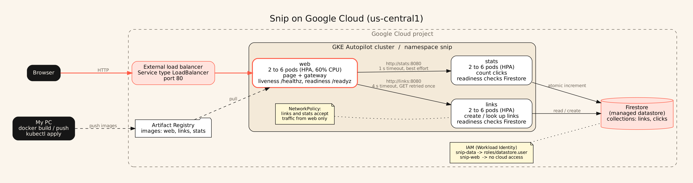

# Snip: AI 255 Project 2

A link shortener built as three containerized services on Google Kubernetes Engine, with Firestore as the managed datastore.

Shafkat Khalek Khan. AI 255 Cloud Computing Concepts, Fall 2026. The written report is `docs/REPORT.pdf`.



| Service | What it does | Public? |
|---|---|---|
| `web` | Serves the page; gateway to the other two | Yes, through the load balancer |
| `links` | Creates and looks up short links (Firestore) | No |
| `stats` | Counts clicks (Firestore) | No |

## What is in this repository

```
services/web      app.py, static/ (index.html, style.css, app.js), Dockerfile, requirements.txt
services/links    app.py, store.py, Dockerfile, requirements.txt
services/stats    app.py, store.py, Dockerfile, requirements.txt
k8s/              Namespace, service accounts, and per service:
                  Deployment + Service + HorizontalPodAutoscaler + PodDisruptionBudget;
                  plus one NetworkPolicy; https/ has the HTTPS load balancer
scripts/          deploy.ps1, experiments.ps1, evidence.ps1, teardown.ps1,
                  smoke_test.py, load_test.py, availability.py, build_report.py
evidence/         output captured from the live cluster (used in the report)
tests/            unit tests for each service and tests of the three together
docs/             REPORT.md, architecture diagram
docker-compose.yml   the whole system on one machine, with the Firestore emulator
```

## Run the tests

```powershell
py -m venv .venv
.venv\Scripts\python -m pip install -r requirements-dev.txt
.venv\Scripts\python -m pytest tests
```

36 tests. They never touch Google Cloud: most use an in-memory store, and the datastore-outage tests point the real Firestore client at an address where nothing is listening. GitHub Actions runs them on every push (`.github/workflows/tests.yml`).

## Run it locally (needs Docker Desktop)

```powershell
docker compose up --build
py scripts\smoke_test.py http://localhost:8080
```

Open http://localhost:8080. Stop one service to see how the others react, for example `docker compose stop stats`.

## Deploy to Google Cloud

You need the gcloud CLI signed in, a project with billing turned on, and kubectl:

```powershell
gcloud components install kubectl gke-gcloud-auth-plugin
```

Then one command does the setup, the image builds and the rollout:

```powershell
.\scripts\deploy.ps1 -ProjectId YOUR_PROJECT_ID
```

Add `-UseCloudBuild` to build the images in Google Cloud instead of with Docker Desktop. The first run takes about 15 minutes, most of it creating the cluster. At the end it prints the public address. Check it:

```powershell
py scripts\smoke_test.py http://ADDRESS
```

### HTTPS

```powershell
.\scripts\deploy.ps1 -ProjectId YOUR_PROJECT_ID -Domain snip.example.com -DnsZone YOUR_CLOUD_DNS_ZONE
```

This reserves a fixed address, points the DNS name at it, and adds a Google HTTPS load balancer with a Google-managed certificate in front of the web pods (`k8s/https/ingress.yaml`). Plain HTTP on that name is redirected to HTTPS. The certificate takes 15 to 60 minutes to be issued the first time; `kubectl -n snip get managedcertificate snip-cert` shows `Active` when it is ready.

The web service also sends security headers on every response (a content security policy, no framing, no content sniffing, HSTS over HTTPS), limits each visitor to 10 new links a minute, and rejects oversized requests.

After a code change, `.\scripts\deploy.ps1 -ProjectId YOUR_PROJECT_ID -Step build` and then `-Step apply` roll out a new image tag.

## Experiments

```powershell
.\scripts\experiments.ps1 -ProjectId YOUR_PROJECT_ID -Address http://ADDRESS
```

Runs the four experiments from the report (kill a pod, load test, stats down, links down) and saves the output into `evidence\`. About 12 minutes.

## Demo

| Show | Command |
|---|---|
| Everything running | `kubectl -n snip get pods,svc,hpa` |
| Health checks | `kubectl -n snip describe deployment links` (Liveness and Readiness lines) |
| Self-healing | `py scripts\availability.py http://ADDRESS 60` in one window, `kubectl -n snip delete pod POD_NAME` in another |
| One request across three services | copy the `X-Request-ID` response header, then `kubectl -n snip logs -l "app in (web,links,stats)" --prefix \| Select-String ID` |
| Horizontal scaling | `py scripts\load_test.py http://ADDRESS 300 60` in one window, `kubectl -n snip get hpa -w` in another |
| stats down, links still work | `kubectl -n snip scale deployment stats --replicas=0`; the status dot turns red; restore with `--replicas=2` |
| links down, clear 503 | `kubectl -n snip scale deployment links --replicas=0`; restore with `--replicas=2` |
| Save outputs for the report | `.\scripts\evidence.ps1 -ProjectId YOUR_PROJECT_ID -Name under-load` |

## Cost and teardown

About $2.55 a day at the minimum size (see the report, Section 8). To stop the charges:

```powershell
.\scripts\teardown.ps1 -ProjectId YOUR_PROJECT_ID
```

## AI use

See Section 10 of the report.
