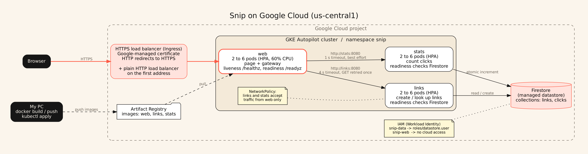

# AI 255 Project 2: Containerized Multi-Service Application

Shafkat Khalek Khan. AI 255 Cloud Computing Concepts, Prof. Yair Chaya, Fall 2026.

**Live endpoint:** {{URL}} (the first address, http://34.171.202.5, also still works)
**Provider:** Google Cloud, region us-central1. **Repository:** https://github.com/ShafkatKhan19/ai255-project2

## 1. Summary

Snip is a link shortener. You paste a long address, get a short one, and the page shows how many times each short link was clicked. I built it as three services, each in its own container image, running on Google Kubernetes Engine (GKE) with Firestore as the managed datastore.

| Requirement | How it is met |
|---|---|
| At least three cooperating services | `web` (page and gateway), `links` (create and look up links), `stats` (count clicks). `web` calls the other two on every request. |
| Managed datastore | Firestore in Native mode. `links` and `stats` each own one collection. |
| Images published to a registry | Three images in Artifact Registry, tagged per build. |
| Orchestration platform | GKE Autopilot (Kubernetes). One Deployment and one Service per service. |
| Health checks | A liveness probe (`/healthz`) and a readiness probe (`/readyz`) on every container. |
| Horizontal scaling | A HorizontalPodAutoscaler per service, 2 to 6 pods, target 60% CPU. |
| Failure modes of each service | Section 6, with experiments in Section 7. |

## 2. Architecture



A request from the browser reaches a Google Cloud load balancer, which sends it to one of the `web` pods. There are two: the HTTPS load balancer on the project's domain name, which holds the certificate, and the plain HTTP one on a bare IP address that I deployed first and kept so the experiments in Section 7 stay reproducible. `web` is the only public service. For a click on a short link, `web` asks `links` for the original address, sends the redirect, and then tells `stats` to add one click. `links` and `stats` are internal: they have ClusterIP Services, so they have no address outside the cluster, and a NetworkPolicy only lets the `web` pods call them.

| Service | Job | Talks to | Stores |
|---|---|---|---|
| web | Serves the page. Gateway for `/api/links` and `/r/{code}`. | links, stats | nothing |
| links | Creates a random 7-character code for an address. Looks codes up. | Firestore | `links` collection |
| stats | Adds one to a counter per click. Returns counts. | Firestore | `clicks` collection |

Two things make the system easier to watch while it runs:

- **Request IDs.** `web` gives every request a 12-character ID, returns it in the `X-Request-ID` header, and sends it to `links` and `stats`. All three services write it in their log line, so `kubectl logs` for one ID shows the whole path of one request.
- **Status panel.** `GET /api/status` asks `links` and `stats` for their readiness and the page shows a green or red dot for each service. When I break a service on purpose, the page shows it within 5 seconds.

Each service is a small Python (FastAPI) program. The services are stateless. All state is in Firestore, which is what makes it safe to run several copies of each one and to kill any pod at any time.

## 3. Containers and registry

Each service has its own folder with its own `Dockerfile` and `requirements.txt`, so each image only contains what that service needs. `web` does not include the Firestore library, and `links` and `stats` do not include the HTTP client.

Choices in the Dockerfiles:

- Base image `python:3.13-slim`, to keep the image small.
- `requirements.txt` is copied and installed before the code. That layer is cached, so changing code does not reinstall the dependencies.
- The container runs as a normal user (uid 10001), not root. In Kubernetes the root filesystem is also read-only and all Linux capabilities are dropped.
- Dependency versions are pinned, so a rebuild gives the same image.

Images are pushed to Artifact Registry as `us-central1-docker.pkg.dev/PROJECT/snip/{web,links,stats}:TAG`. The tag is the build time, and the manifests always name an exact tag, never `latest`, so I know which build is running and can roll back to an earlier one.

Images in the registry (the rows without a tag are the per-platform manifest and build record that Docker pushes alongside each tagged image):

```
{{EVIDENCE:baseline-images}}
```

## 4. Orchestration, health checks and scaling

The manifests are in `k8s/`. For each service there is a Deployment, a Service, a HorizontalPodAutoscaler and a PodDisruptionBudget.

**Health checks.** Every container has two probes, and they answer different questions.

- Liveness (`/healthz`): is the process answering at all? It never touches Firestore. If it fails three times in a row, Kubernetes restarts the container.
- Readiness (`/readyz`): can this pod do useful work right now? For `links` and `stats` it does a small read from Firestore. If it fails, the pod keeps running but is taken out of the Service, so no requests are sent to it until it passes again.

I kept the datastore check out of the liveness probe on purpose. If Firestore had a problem, a liveness probe that depended on it would restart every pod over and over, which fixes nothing and makes recovery slower. The liveness handler also does not share worker threads with the datastore calls, so it still answers when every worker is stuck waiting for Firestore. There is a test for exactly that case (60 stuck requests, liveness must answer in under half a second).

The `web` readiness probe does not check `links` or `stats`. If it did, one broken backend would mark every `web` pod unready, and visitors would get a connection error from the load balancer. This way `web` stays up and returns a clear 503 message.

**Scaling.** Each HorizontalPodAutoscaler keeps between 2 and 6 pods and adds pods when average CPU goes above 60% of the request (250m). Two is the minimum so that one pod can die, or be replaced during an update, without the service going down. On Autopilot, Google adds nodes by itself when new pods need room.

**Updates.** Rolling updates use `maxSurge: 1` and `maxUnavailable: 0`: a new pod has to pass its readiness probe before an old one is removed. A `preStop` sleep of 5 seconds gives the Service time to stop sending requests to a pod before it shuts down.

**Spreading.** Each Deployment has a topology spread rule so its pods are spread evenly over zones. I first wrote it as a preference (`ScheduleAnyway`). The first deployment then put all six pods on one node, which `kubectl get pods -o wide` showed straight away: one node failure would have taken down every copy of every service. I changed the rule to a requirement (`DoNotSchedule`) and redeployed. The listing below is from after that change; the NODE column shows each service's two pods on different nodes. The experiments in Section 7 were run before this change.

State of the cluster after deployment:

```
{{EVIDENCE:baseline-pods}}
```

```
{{EVIDENCE:baseline-hpa}}
```

Probes and images as Kubernetes sees them:

```
{{EVIDENCE:baseline-probes}}
```

Actual use when idle, from `kubectl top pods`:

```
{{EVIDENCE:baseline-top}}
```

## 5. Security

- **HTTPS.** The site is served at a domain name through a Google HTTPS load balancer with a Google-managed certificate, which Google renews by itself. Plain HTTP on that name is redirected to HTTPS, and responses over HTTPS carry an HSTS header. The parent domain only allowed Let's Encrypt to issue certificates (a CAA record from Project 1), so I added a CAA record for this name that also allows Google's certificate authority.
- **Security headers.** Every response carries a content security policy that only allows scripts and styles from the site itself, so text injected into the page cannot run as code. The page has no inline script for that reason. Other headers stop the page being shown in a frame on another site and stop browsers guessing content types.
- **Rate limit.** Each visitor can create 10 links a minute per web pod; after that web answers 429 with `Retry-After`. Requests over 4 KB are rejected. The visitor's address is taken from the entry the load balancer adds to `X-Forwarded-For`, not from what the visitor sends, and there is a test that a made-up address does not get around the limit.
- **No keys in the cluster.** `links` and `stats` run as the Kubernetes service account `snip-data`. Through Workload Identity that account has one IAM role, `roles/datastore.user`. There is no key file in the image or in a Secret.
- **The public service has no cloud access.** `web` runs as `snip-web`, which has no IAM role, and its service account token is not mounted.
- **Network.** Only `web` is exposed. A NetworkPolicy blocks everything except `web` from calling `links` and `stats`.
- **Input.** `links` only accepts `http://` and `https://` addresses up to 2048 characters. Codes are checked against `[a-z0-9]` before they are used as Firestore document names.

## 6. Failure modes of each service

For each service I list what can go wrong, what the user sees, and what limits the damage. "Tested" means there is an automated test in `tests/test_system.py` or an experiment in Section 7.

### 6.1 web

| Failure | What happens | What limits it |
|---|---|---|
| One web pod crashes or is killed | Requests in flight on that pod fail. New requests go to the other pod. Kubernetes starts a replacement. | Minimum of 2 pods, liveness probe, Deployment controller. Tested (7.1). |
| A web pod hangs but does not exit | The liveness probe fails 3 times (about 30 s) and the container is restarted. The readiness probe fails first (about 10 s) and removes it from the load balancer. | Liveness and readiness probes. |
| More traffic than the pods can handle | Responses slow down until the autoscaler adds pods. New pods can take a minute or more if Autopilot has to add a node. | HPA at 60% CPU. Tested (7.2). The delay is a real gap: a sudden spike is slow for that first minute. |
| links is down | Creating, listing and following links return 503 with `Retry-After: 5`. The page itself still loads and shows a red banner and a red status dot. web recovers by itself when links is back. | Clear error instead of hanging. Tested (7.4). |
| links is slow, not down | web waits at most 4 s, then returns 503. It does not retry. | The timeout stops requests piling up in web. Not retrying matters: a retry against a service that is already too slow only adds load to it. Tested. |
| stats is down | Links still work. The list shows "?" for clicks and a banner. Clicks made during the outage are not counted. | 1 s timeout, and the click is sent after the redirect, so stats can never slow down or break a redirect. Tested (7.3). |
| A bad image is deployed | The new pod never becomes ready, so the old pods keep serving. The rollout stalls and can be undone with `kubectl rollout undo`. | `maxUnavailable: 0` and the readiness probe. |
| All web pods or the whole region are lost | The site is down. | Pods are spread over zones in the region, so one zone can fail. There is no second region. |

web does not retry everything. A GET to links is retried once, and only when the connection itself failed, because a GET can be repeated safely and the usual cause is a pod that was just killed. A timeout is not retried. A failed POST is not retried either, because web cannot tell whether links already saved the link, and a retry could create a second one.

web reuses connections to links and stats but drops idle ones after 5 seconds. A Kubernetes Service picks a pod when a connection is opened, not for each request, so connections kept open for a long time would keep sending everything to the same pods and ignore the new ones the autoscaler adds.

### 6.2 links

| Failure | What happens | What limits it |
|---|---|---|
| One links pod crashes | web's request fails at the connection, is retried once, and reaches the other pod. | 2 pods, retry on GET. Tested (7.1). |
| Firestore cannot be reached or is slow | Every Firestore call is limited to 3 s and becomes a 503. The readiness probe fails, so the pod is removed from the Service. Liveness stays green, so pods are not restarted for something a restart cannot fix. | Explicit time limit on every call (see 6.5), readiness probe, 503 passed to the user by web. Tested against an unreachable Firestore address. |
| Two requests pick the same random code | The second create fails inside Firestore (`create` refuses to overwrite) and links picks a new code, up to 5 times. | Firestore's create-if-absent. Tested. |
| web times out after links already saved the link | The user sees an error, tries again, and gets a second short link for the same address. The first one is left unused. | Nothing. This is a known weakness: creating is not idempotent. A fix is for the browser to send a request ID that links stores with the link. |
| Someone floods the service with new links | Firestore writes cost money and the list fills with junk. | web limits each visitor to 10 new links a minute per pod (429 after that). It slows one visitor down; it does not stop many visitors at once, and there is no login. Tested. |
| Permission is removed from `snip-data` | Same as Firestore being down: 503 and pods not ready. | Readiness probe makes it visible quickly. |

### 6.3 stats

| Failure | What happens | What limits it |
|---|---|---|
| One stats pod crashes | A click sent to that pod at that moment is lost. Later clicks go to the other pod. | 2 pods. Lost clicks are accepted. |
| All stats pods are down | Redirects keep working; counts are hidden; clicks during the outage are lost for good. | The design choice that stats is optional. Tested (7.3). |
| Two pods count a click for the same link at the same time | Both are counted. | Firestore applies `Increment(1)` itself, so one pod cannot overwrite the other. |
| One link gets a very large number of clicks per second | Firestore slows down or rejects writes when a single document is updated many times per second, so some clicks are lost. | Nothing in this version. The fix is to put clicks on a queue and count them in batches, which is what I plan for the capstone. |
| Firestore cannot be reached | Same as links: 503 within 3 s, readiness fails, liveness stays green. | Time limit on every call and readiness probe. Tested. |

Clicks are counted at most once. A click is never counted twice, because web sends it once and stats sends the increment to Firestore once, with no retry at either step, but it can be missed. For a click counter I think that is the right way round. For something like payments it would not be.

### 6.4 The managed datastore and the platform

- **Firestore** is run by Google and replicated across regions (`nam5`), so I do not manage its failures, but I depend on it completely: with Firestore down, nothing can be created or looked up. The only part that still works is the page itself.
- **The cluster** is regional, so the control plane and the pods survive the loss of one zone.
- **Planned maintenance** (node upgrades) is covered by the PodDisruptionBudgets, which never allow the last pod of a service to be taken down.

### 6.5 A failure mode I only found by testing

My first version passed `timeout=3` to every Firestore call and I assumed that meant a call could take at most 3 seconds. To check, I pointed the Firestore client at an address where nothing was listening. The first call was still hanging after 100 seconds. The timeout applies to one attempt, and the client library's default retry policy keeps making new attempts for much longer.

In the cluster this would have been bad. During a Firestore outage every request would hold a worker thread for minutes, the workers would run out, and the liveness probe (which then used the same workers) would time out, so Kubernetes would restart healthy pods in a loop. That is the opposite of what Section 4 says the probes are for.

The fix has two parts. Reads now use a retry policy that gives up after 3 seconds in total, and writes are sent once with no retry. And the liveness handler no longer uses the worker threads. After the fix, every Firestore call against the unreachable address fails in under 3 seconds (measured between 0.0 and 2.6 s). Both parts have tests in `tests/test_datastore_outage.py`, and the liveness test fails if I put the old handler back.

## 7. Experiments

Before deploying I ran the three services as separate processes on one machine and broke them one at a time, with `scripts/availability.py` sending 5 requests a second to `/api/links`:

- **stats stopped.** Redirects still returned 307 in about 3 ms and the list returned `stats_available: false`.
- **links stopped for 2 seconds, then started again.** Of 40 requests in 8 seconds, 29 returned 200 and 11 returned 503. All failures fell between t=3.2 s and t=5.2 s, the time links was down. No request went unanswered, and web recovered without a restart.

The same cases, plus the datastore outage in 6.5 and the security checks in Section 5, run automatically in `tests/` (36 tests). These local runs used an in-memory store in place of Firestore, so they test the services and how they depend on each other, not Firestore itself.

The experiments below were run on the live cluster on 15 November 2026 with `scripts/experiments.ps1`, which runs each one and saves the output into `evidence/`. Everything shown is copied from those files. They were run against the first address (http://34.171.202.5), before HTTPS was added; the same end-to-end check passes on the HTTPS address.

### 7.1 Kill a pod

`py scripts\availability.py http://ADDRESS 60` in one window; in another, `kubectl -n snip delete pod <one web pod>` and then `<one links pod>`.

```
{{EVIDENCE:kill-pod-actions}}
```

Last lines of `availability.py`:

```
{{EVIDENCE:kill-pod-summary}}
```

Pods afterwards:

```
{{EVIDENCE:kill-pod-pods}}
```

{{NOTES:kill-pod}}

### 7.2 Horizontal scaling under load

`py scripts\load_test.py http://ADDRESS 300 80` (80 threads for 5 minutes), with the web autoscaler recorded every 30 seconds. The columns are target, min, max and current replicas.

```
{{EVIDENCE:under-load-timeline}}
```

Load generator output (every 10 seconds; middle rows left out):

```
{{EVIDENCE:under-load-summary}}
```

Pods at the end of the load:

```
{{EVIDENCE:under-load-pods}}
```

{{NOTES:under-load}}

### 7.3 stats down

`kubectl -n snip scale deployment stats --replicas=0`, click some links, then `--replicas=2` to bring it back. (The autoscaler leaves a Deployment alone while it is at zero.)

```
{{EVIDENCE:stats-down-actions}}
```

```
{{EVIDENCE:stats-down-summary}}
```

{{NOTES:stats-down}}

### 7.4 links down

The same with `links`.

```
{{EVIDENCE:links-down-actions}}
```

```
{{EVIDENCE:links-down-summary}}
```

{{NOTES:links-down}}

## 8. Cost

GKE Autopilot bills for what the pods request, not for nodes. At the minimum size (6 pods, each 0.25 vCPU and 0.5 GiB) in us-central1:

| Item | Calculation | Per day |
|---|---|---|
| Pod CPU | 1.5 vCPU x $0.0445 per hour x 24 | $1.60 |
| Pod memory | 3 GiB x $0.0049225 per hour x 24 | $0.35 |
| Cluster fee | $0.10 per hour, covered by the GKE free tier credit for one cluster | $0.00 |
| Load balancer (HTTP, first address) | one forwarding rule, about $0.025 per hour | $0.60 |
| HTTPS load balancer | two more forwarding rules and one reserved address; at most 2 x $0.025 + $0.005 per hour | up to $1.32 |
| Firestore | see below | about $0.00 |
| **Total** | | **about $2.55 to $3.90** |

At the maximum of 6 pods per service the pod cost triples, for a total of about $6.50 to $7.80 a day.

Firestore gives 50,000 free document reads and 20,000 free writes a day. Two things read from it even with no visitors: the readiness probes (4 backend pods, one read every 20 seconds, about 17,000 reads a day) and any browser tab that has the page open (with 10 links, about 22 reads every 5 seconds, or 16,000 an hour). So about two hours with the page open uses up the free reads for the day. After that, reads are billed at a few cents per 100,000, so a full day with the page open costs well under a dollar. I reduced this in two ways: the page stops refreshing when its tab is hidden, and stats only reads the counters for the links being shown instead of all of them. The biggest saving available is lowering the requests. When idle each pod uses about 3m of CPU and 40 to 75 Mi of memory (Section 4), against requests of 250m and 512 Mi. Requests of 100m and 128 Mi would cut the pod cost by more than half, at the price of the autoscaler reacting to smaller amounts of traffic.

## 9. What I would change

- Remove the plain HTTP address once it is no longer needed, so HTTPS is the only way in.
- Put clicks on a queue (Pub/Sub) so they survive a stats outage and so one popular link cannot overload a single counter document.
- Make link creation idempotent with a request ID.
- Share the rate limit between pods (for example in Redis). Now each web pod counts on its own.
- Cache the link list in web for a couple of seconds. It would cut Firestore reads a lot under many viewers, but with several web pods a new link could be missing from the list for a moment, so I left it out for now.
- Scale on requests per second instead of CPU, which reacts sooner for this kind of service.
- Move everything in `scripts/deploy.ps1` into Terraform and a pipeline. That is Project 3.

## 10. Use of AI tools

{{AI_DISCLOSURE}}
